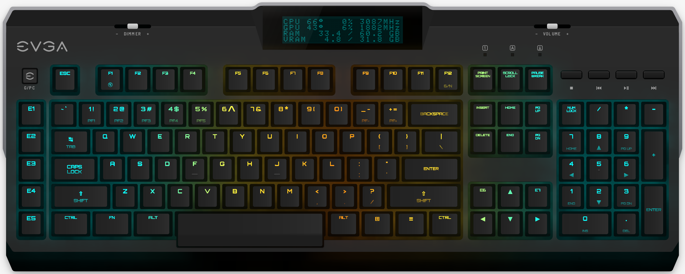

# EVGA Z10 RGB for Ectomatter

Keys, lighting and the screen of the EVGA Z10 RGB.



This is a core for [Ectomatter](https://github.com/Ectonomic/Ectomatter), one app for the devices on your desk. A core is the part of Ectomatter that talks to one device. It runs inside Ectomatter as a WebAssembly module and reaches only the USB devices its manifest (`core.json`) names.

It is independent: not made, endorsed or supported by EVGA.

## Adding it

In Ectomatter's Settings, under Devices, choose **Add a device core**, then pick EVGA Z10 RGB and press **Add**. Ectomatter shows what the core can reach before you add it, and takes the package only if it matches the checksum in Ectonomic's list of reviewed packages, [ectomatter-packages](https://github.com/Ectonomic/ectomatter-packages).

## Building it

The core is built inside Ectomatter's repository, which links this one at `cores/evga-z10` (a Git submodule) and holds what every package is built from: the library of the core protocol's names (`crates/ectomatter-protocol`) and the interface between a module and Ectomatter (`wit/core.wit`).

```sh
git clone --recurse-submodules https://github.com/Ectonomic/Ectomatter
cd Ectomatter
rustup target add wasm32-wasip2
tools/build-module.sh cores/evga-z10/module/Cargo.toml cores/evga-z10/core.wasm
```

Ectonomic builds its releases with Rust 1.98.1.

- `core.json`, `device.json`, `glyph.svg`, `art/`, `fonts/`: the core as Ectomatter installs it, its manifest and the files it carries
- `module/`: the module's source
- `pictures/`: the picture at the top of this README, made in Ectomatter's repository by `tools/readme-moving.sh`, and not part of the core
- `crates/`: the core's own library, which its module is built from
  - `evga-z10`: talks to the EVGA Z10 RGB keyboard: profiles, key assignments, lighting, macros and the LCD
- `tools/z10-art/`: the tools the keyboard's drawing (`art/z10.svg`) and its typefaces (`fonts/`) were made with
- `parity/`: the cases the `evga-z10` library's tests replay (`cargo test -p evga-z10`)

The keyboard's protocol was worked out from EVGA's Unleash RGB 1.0.11.0 and, for the display, from AIDA64. The firmware updater's commands are deliberately not part of it.

## License

Copyright (C) 2026 Ectonomic LLC. Made by Grant Garrison and Claude.

This core is free software under the GNU General Public License, version 3 only (`LICENSE`): you may share and change it under its terms. It comes with no warranty. The files it carries from others are under their own licenses, named in `REUSE.toml`, with their texts in `LICENSES/`.
